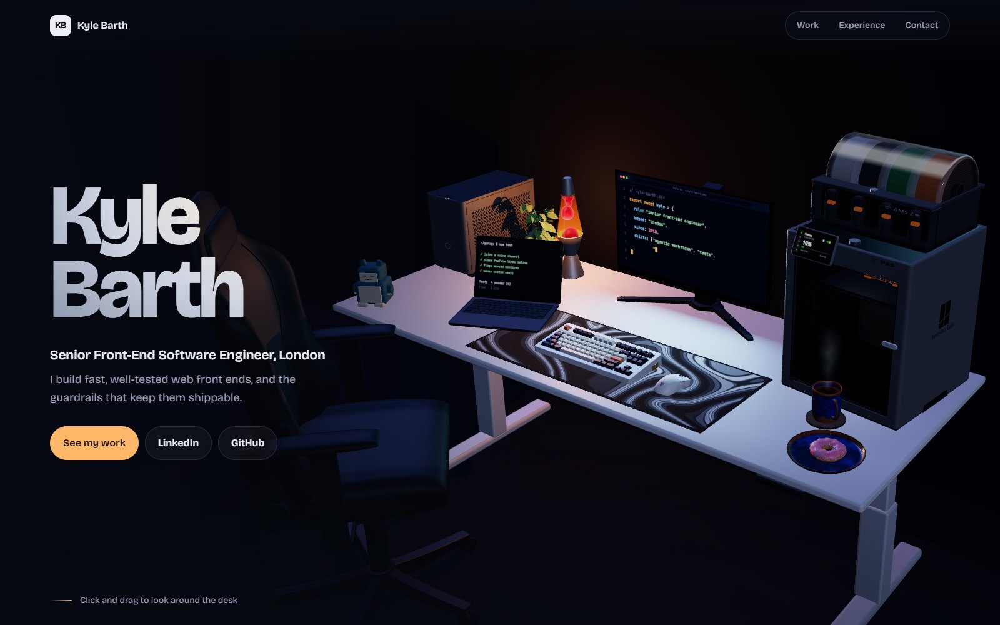
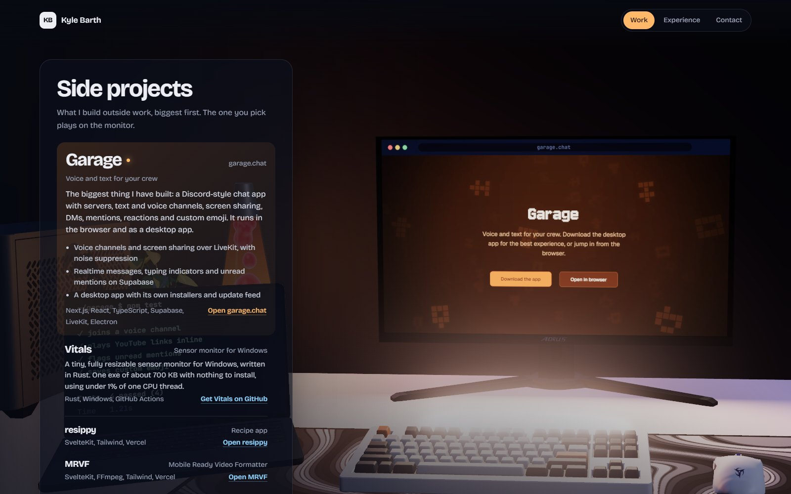
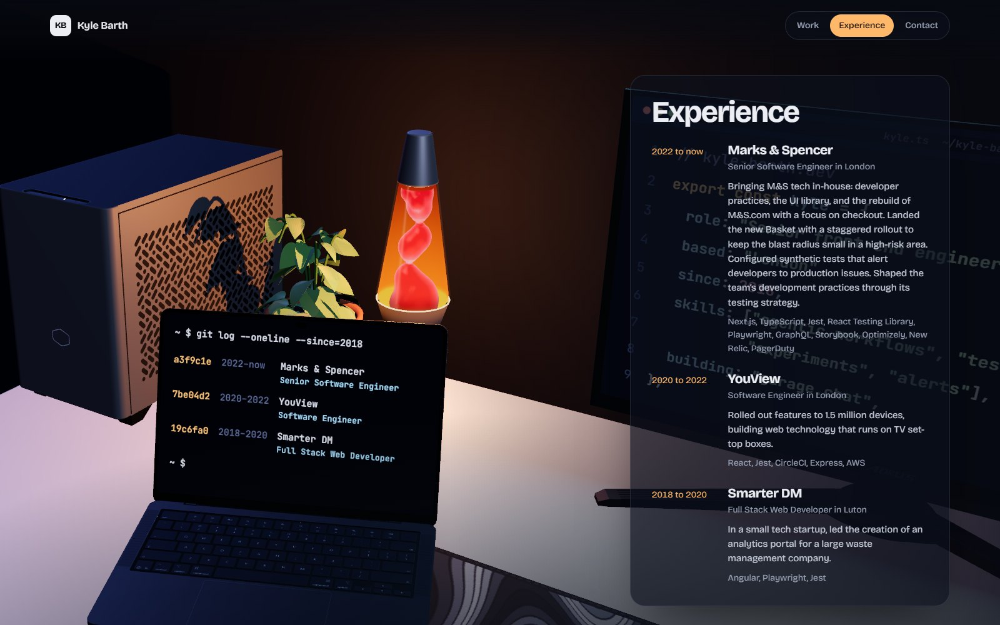
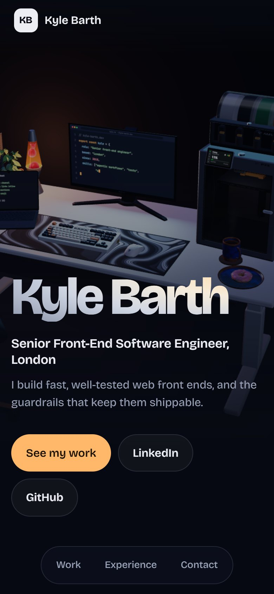
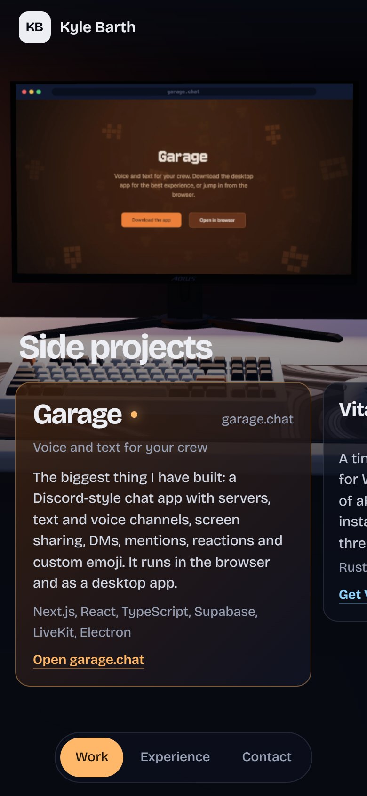
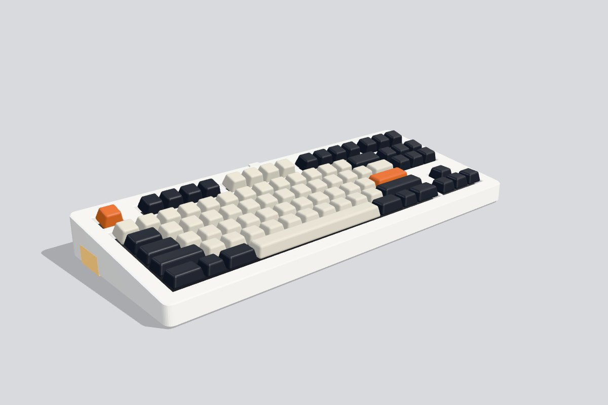
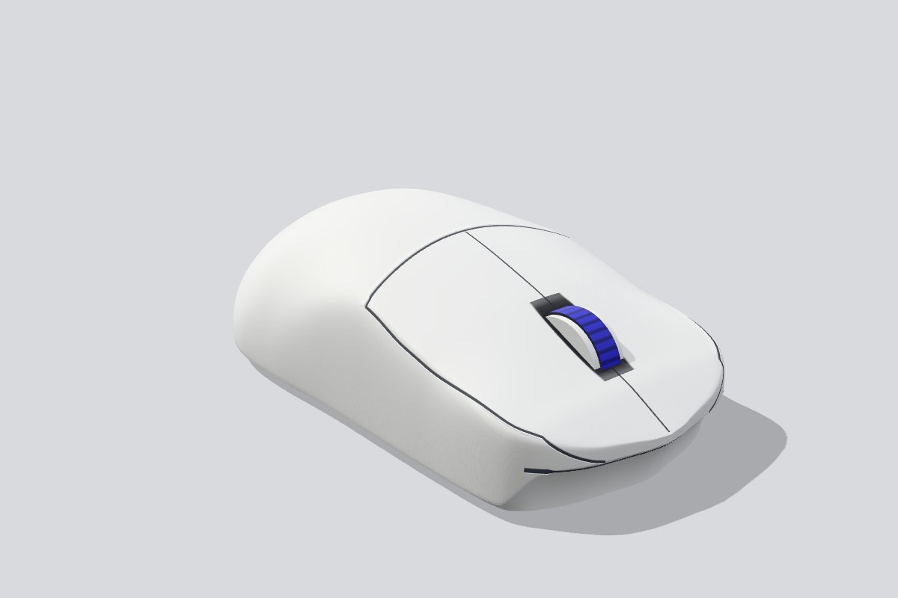
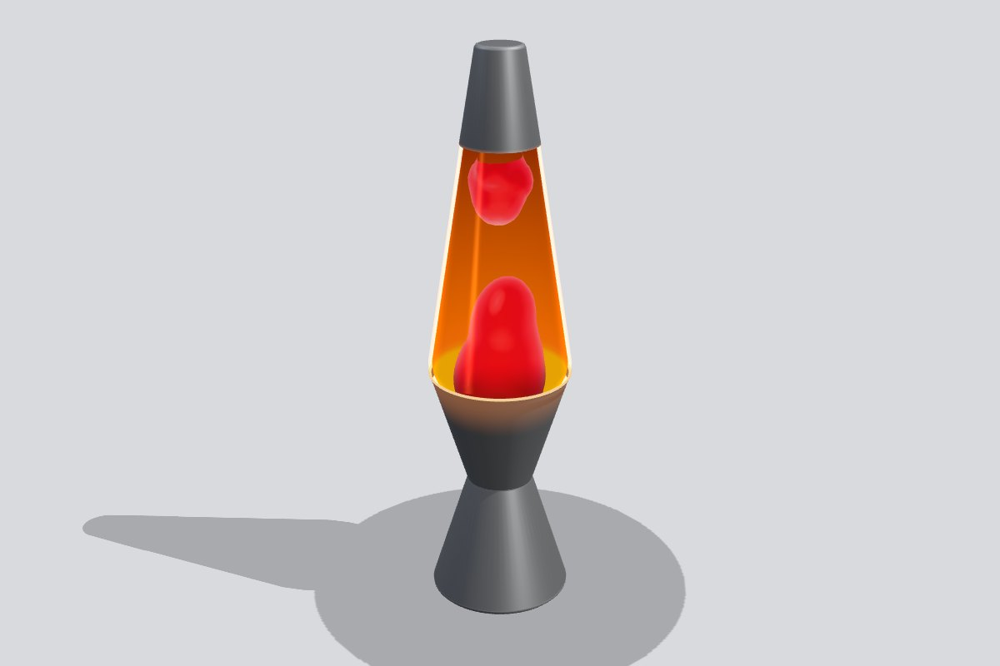

# kyle-barth.dev

Welcome to my portfolio. It's one page, with my desk rebuilt in three.js and rendered at night behind it.
Scroll, and the camera moves to a new shot for each section: the monitor plays my side projects, the
laptop prints my career as a git log, and a lava lamp lights the room.

<p align="center">
  
</p>
<p align="center">
  
  
  
  
</p>

## How it's built

- **Next.js 16, React 19 and TypeScript.** One static page. The text is in the HTML, and the 3D loads after it.
- **three.js, with no model files.** Every prop on the desk is code, built from simple shapes (turned
  profiles, extrusions, lofts) and merged by material, so the whole desk draws in a few calls.
- **Live screens.** The monitor and laptop screens are canvases drawn as textures: a boot log while the
  site loads, then code, my side projects, and my jobs.
- **A boot sequence.** The page opens on the monitor's boot log, the lava lamp switches on, and the camera
  pulls back. The slow work (building the desk, compiling shaders) is done before the lamp comes on, so
  the motion doesn't stutter.
- **The lava lamp** is metaballs, rebuilt every frame, and it's the room's main light.
- **Scrolling goes a section at a time.** [wheel-gestures](https://github.com/xiel/wheel-gestures) tells
  a touchpad swipe from its coasting, phones use CSS scroll snapping, and every page turn glides.
- **Hosted on Vercel.**

## Making the 3D assets with an agent

Every prop is modelled on the real thing, and an AI coding agent ([Claude Code](https://claude.com/claude-code))
built them in a loop it could check for itself:

1. **Spec it.** The real object's measurements go into a spec file, in millimetres, with sources: the
   maker's numbers, and product photos measured in pixels (`lib/scene/specs/`, for the monitor, MacBook,
   PC, mouse, printer and lava lamp).
2. **Build it** in code from the spec alone (`lib/scene/props/`).
3. **Look at it.** `?lab=keyboard` puts one prop on its own in studio light, and `__labCapture()` renders
   it from every side for the agent to look at.
4. **Measure it.** `__labCheck()` measures every dimension in the spec off the built model, and
   `__labOverlay()` lays the model over a reference photo and scores how closely the outlines match.
5. **Repeat** until the numbers and the pictures agree.

<p align="center">
  
  
  
</p>

On the desk:
- Gigabyte AORUS FO27Q3 monitor
- MacBook Pro 14"
- Cooler Master NR200P MAX PC
- Rama U80-A keyboard
- Ninjutso Sora V2 mouse
- Secretlab TITAN Evo chair
- Bambu Lab P2S 3D printer and AMS 2 Pro
- 14.5" Lava lamp
- a pothos, a Snorlax, a coffee and a donut

## Run it

```bash
pnpm install
pnpm dev
```

Uses Node 26 and pnpm. Add `?lab=mouse` (or `keyboard`, `monitor`, `macbook`, `pc`, `chair`, `printer`,
`lava`, `tableware`) to the address to see a prop on its own.
